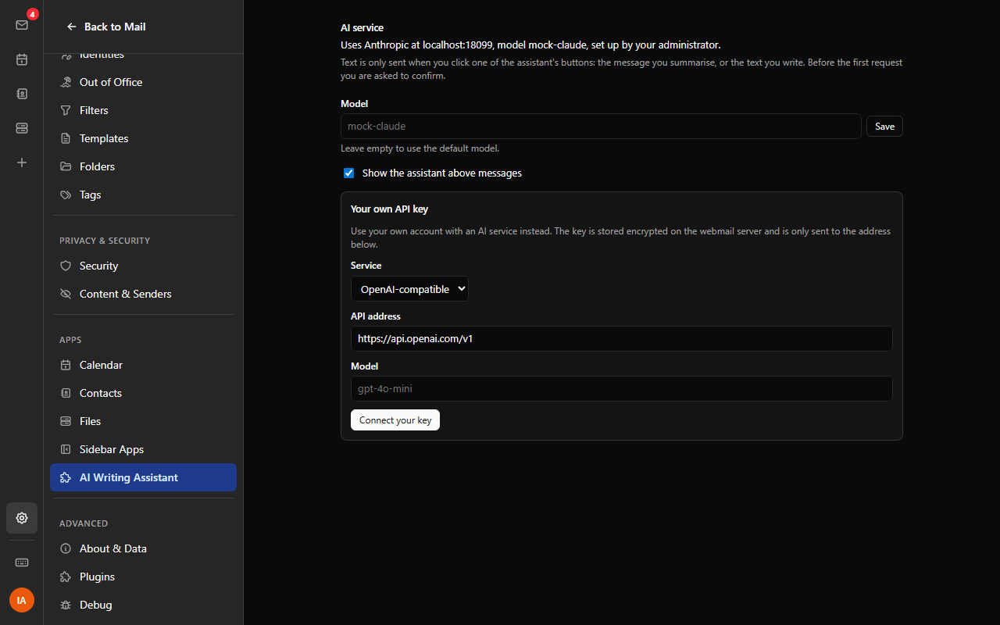

# AI Writing Assistant

Write, rewrite, translate and proofread emails, and summarise messages,
with an OpenAI-compatible service (OpenAI, Ollama, LM Studio, vLLM, ...) or
the Anthropic Messages API.

Nothing is sent to the AI service until the user clicks one of the
assistant's buttons, and before the first request to a service the user
sees which service it is, where the text goes and which model answers.

## Setting it up (administrator)

Install `ai-assistant.zip` in the admin dashboard, then fill in its
settings. Set up one or both services:

| Setting | What to enter |
| --- | --- |
| OpenAI-compatible API address | Up to and including `/v1`: `https://api.openai.com/v1`, or `http://ollama:11434/v1` for Ollama |
| OpenAI-compatible API key | The key. Ollama needs none, but the field must not be empty: enter any text |
| OpenAI-compatible model | e.g. `gpt-4o-mini`, or `qwen2.5:7b` on Ollama |
| Anthropic API address | `https://api.anthropic.com/v1` |
| Anthropic API key | The key |
| Anthropic model | e.g. `claude-haiku-4-5` |
| Default service | Which one users get when both are set up |
| Let users connect their own API key | Off by default |

The keys stay on the webmail server. The plugin asks the webmail's server
proxy to send each request "with the OpenAI key" or "with the Anthropic
key", and the server adds the key and only sends it to the address above.

An address on your own network (Ollama on the same host, say) is only
reachable when its origin is listed in `PLUGIN_PROXY_PRIVATE_ORIGINS` on
the webmail server, e.g. `PLUGIN_PROXY_PRIVATE_ORIGINS=http://ollama:11434`.

## Settings (users)

Settings > AI Writing Assistant shows which service and model are used. A
user can pick another model, choose between the two services when both
are set up, and hide the assistant bar above messages. When the
administrator allows it, a user can connect their own key: they pick the
service and address here, and type the key into the webmail's own dialog,
so the plugin never sees it. Their key is stored encrypted on the server.

## Permissions

| Permission | Why |
| --- | --- |
| `http:proxy` | Send requests to the AI service through the webmail's server, which adds the API key |
| `admin:config` | Read the administrator's settings (addresses and models; the host never hands out the keys) |
| `ui:settings-section` | The plugin's settings page |

## Credentials

| Id | Set up by | Sent as |
| --- | --- | --- |
| `openai` | administrator | `Authorization: Bearer <key>` to the OpenAI-compatible address |
| `anthropic` | administrator | `x-api-key: <key>` to the Anthropic address |
| `own-openai` | user, if allowed | `Authorization: Bearer <key>` to the address the user approved |
| `own-anthropic` | user, if allowed | `x-api-key: <key>` to the address the user approved |

## Errors

The user gets a plain sentence instead of an error code: the key was
refused (401), no permission for the model (403), unknown model or
address (404), too many requests (429, with the wait time from
`retry-after` and a Try again button that waits it out), no credit left,
service overloaded (529/503), no answer for 60 seconds, text too long,
or the service can't be reached.

## Tests

```
node node_modules/vitest/vitest.mjs run ai-assistant
BULWARK_ADMIN_PASSWORD=... node node_modules/@playwright/test/cli.js test -c e2e/playwright.config.mjs ai-assistant/e2e
```

The end-to-end tests run against the Anthropic and OpenAI mocks of
`test-env` (`http://localhost:18099`).

## Screenshots



