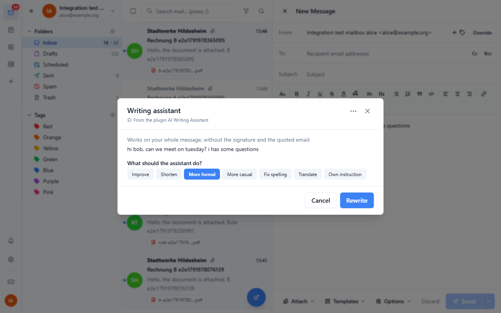
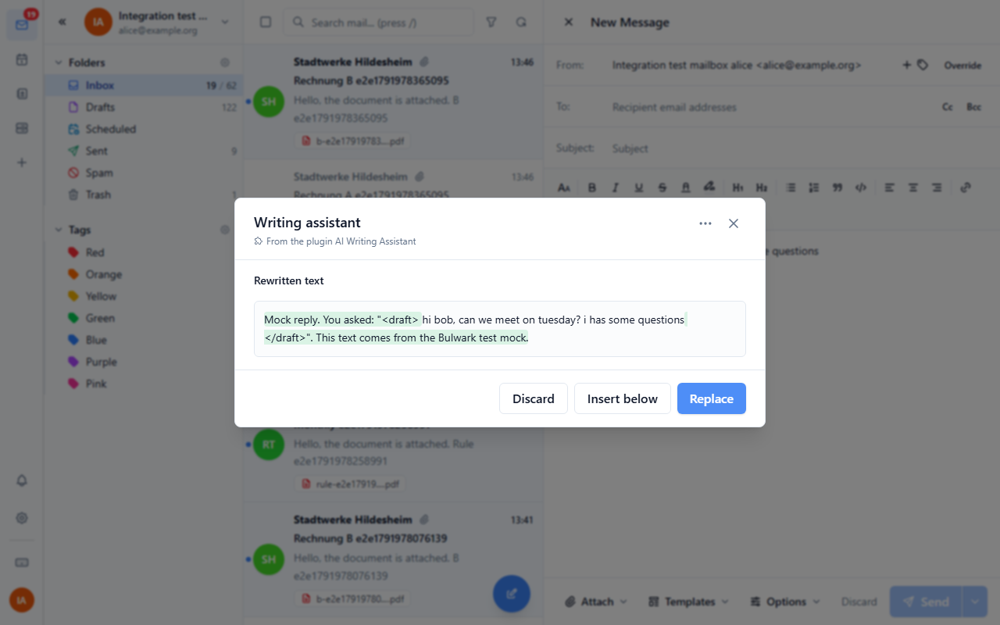
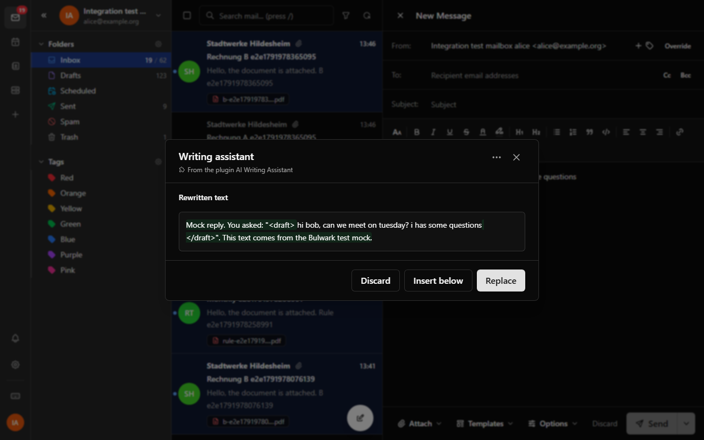
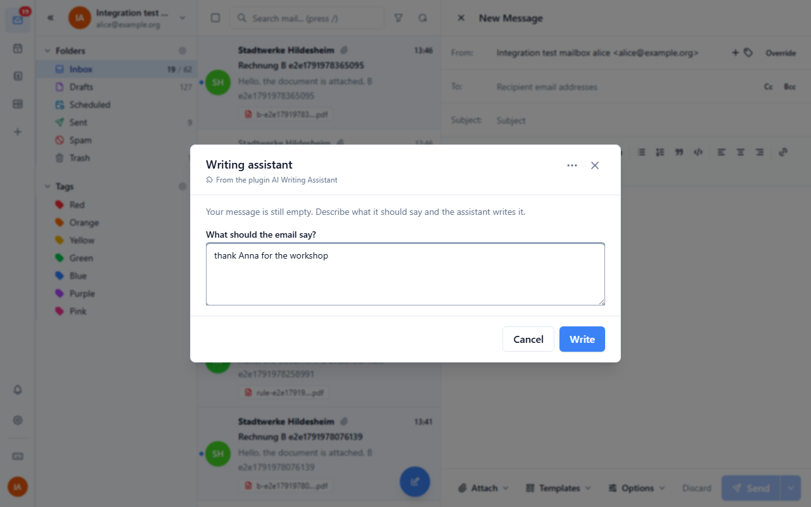
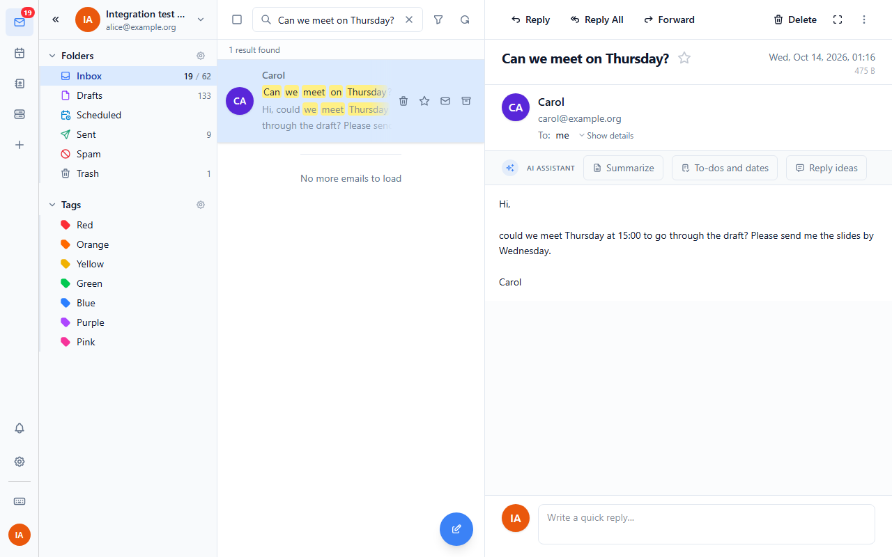

# AI Writing Assistant

Write, rewrite, translate and proofread emails, and summarise messages and
conversations, with an OpenAI-compatible service (OpenAI, Ollama, LM
Studio, vLLM, ...) or the Anthropic Messages API.

Nothing is sent to the AI service until the user clicks one of the
assistant's buttons. Before the first request to a service the user sees
which service it is, which server the text goes to and which model
answers, and has to confirm.

## What it does

In the composer, the **Assistant** button in the bottom bar (after
Attach, Templates and Options), or **Alt+A** while writing, opens the
writing assistant. It works on the selected text, or on the whole
message when nothing is selected. The signature and the quoted message
of a reply are never sent and never changed. Pick what to do:

- **Improve**, **Shorten**, **More formal**, **More casual**.
- **Translate** into one of 32 languages (the last one used is remembered).
- **Own instruction**: say what to change ("add that I'm away next week").
- **Fix spelling**: each correction is listed and accepted or kept as
  written one by one, or all at once.

The answer comes in as a preview with the change marked: removed words
struck out, new ones highlighted. **Replace** puts it in place of the
selection (or the whole message), **Insert below** adds it after the
selection, **Discard** goes back. Either change is one step in the
composer's undo, so Ctrl+Z takes it back. When the message is still
empty, the assistant writes it from a description instead ("thank Anna
and propose Tuesday at 10") and **Insert** puts it in.

Above an open message, an info bar offers:

- **Summarize**: two to four points, in the user's language.
- **To-dos and dates**: action items with due dates, and deadlines and
  appointments, as two lists. **Copy list** copies them as a checklist.
- **Reply ideas**: three short replies in the language of the message.
  **Reply** next to one opens a reply that already says it.

Above a conversation, **Summarize this conversation** summarises up to the
last 20 messages. The bar can be hidden in the plugin's settings.

Mail text is put between tags and the model is told that it is data, not
instructions, so a message that says "ignore your instructions" is
summarised, not obeyed. Very long texts are cut at 30 000 characters.

## Setting it up (administrator)

Install `ai-assistant.zip` in the admin dashboard, then fill in its
settings. Set up one or both services:

| Setting | What to enter |
| --- | --- |
| OpenAI-compatible API address | Up to and including `/v1`: `https://api.openai.com/v1`, or `http://ollama:11434/v1` for Ollama |
| OpenAI-compatible API key | The key. Ollama needs none, but the field must not be empty: enter any text |
| OpenAI-compatible model | e.g. `gpt-4o-mini`, or `qwen2.5:7b` on Ollama |
| Anthropic API address | `https://api.anthropic.com/v1` (Ollama also speaks this API at `http://ollama:11434/v1`) |
| Anthropic API key | The key |
| Anthropic model | e.g. `claude-haiku-4-5` |
| Default service | Which one users get when both are set up |
| Let users connect their own API key | Off by default |

Without a model the defaults are `gpt-4o-mini` and `claude-haiku-4-5`.

The keys stay on the webmail server. The plugin asks the webmail's server
proxy to send each request "with the OpenAI key" or "with the Anthropic
key", and the server adds the key and only sends it to the address above.

An address on your own network (Ollama on the same host, say) is only
reachable when its origin is listed in `PLUGIN_PROXY_PRIVATE_ORIGINS` on
the webmail server, e.g. `PLUGIN_PROXY_PRIVATE_ORIGINS=http://ollama:11434`.

## Settings (users)

Settings > AI Writing Assistant shows which service and model are used. A
user can pick another model, choose between the two services when both
are set up, and hide the assistant bar above messages. When the
administrator allows it, a user can connect their own key: they pick the
service and address here, and type the key into the webmail's own dialog,
so the plugin never sees it. Their key is stored encrypted on the server
and only sent to the address they approved there.

## What is sent where

| When the user clicks | What is sent to the AI service |
| --- | --- |
| Write (empty message) | The description and the subject |
| Improve, Shorten, More formal, More casual, Translate, Own instruction, Fix spelling | The selected text, or the user's own text of the message (no signature, no quote), and the instruction |
| Summarize, To-dos and dates, Reply ideas | Sender, date, subject and text of the open message |
| Summarize this conversation | Sender, date, subject and text (without quotes) of up to 20 messages |

Nothing else leaves the webmail. In the browser the plugin keeps the
user's choices, which services they confirmed, and, while a composer is
open, the draft's subject for the write prompt (removed when the
composer closes).

## Permissions

| Permission | Why |
| --- | --- |
| `email:read` | Read the open message and conversation for summaries, and the draft's subject (onDraftChange) |
| `http:proxy` | Send requests to the AI service through the webmail's server, which adds the API key |
| `admin:config` | Read the administrator's settings (addresses and models; the host never hands out the keys) |
| `ui:email-banner` | The bar above a message and the conversation summary (`email-banner`, `thread-summary`) |
| `ui:composer-toolbar` | The Assistant button in the composer's bottom bar (`composer-toolbar-actions`) |
| `ui:settings-section` | The plugin's settings page |
| `compose:read` | Read the selection or the user's own text of the message the assistant was opened for |
| `compose:write` | Replace the selection or the message, or insert below it, when the user clicks Replace or Insert |
| `compose:open` | Open a reply with a reply idea in it |

## Credentials

| Id | Set up by | Sent as |
| --- | --- | --- |
| `openai` | administrator | `Authorization: Bearer <key>` to the OpenAI-compatible address |
| `anthropic` | administrator | `x-api-key: <key>` to the Anthropic address |
| `own-openai` | user, if allowed | `Authorization: Bearer <key>` to the address the user approved |
| `own-anthropic` | user, if allowed | `x-api-key: <key>` to the address the user approved |

## Errors

The user gets a plain sentence instead of an error code: the key was
refused (401), no permission for the model (403), unknown model or
address (404), too many requests (429, with the wait time from
`retry-after` and a Try again button that waits it out), no credit left,
service overloaded (529/503), no answer for 60 seconds, text too long,
or the service can't be reached.

## Tests

```
node node_modules/vitest/vitest.mjs run ai-assistant
BULWARK_ADMIN_PASSWORD=... node node_modules/@playwright/test/cli.js test -c e2e/playwright.config.mjs ai-assistant/e2e
```

The end-to-end tests need the webmail and `test-env` running, with
Ollama (`up.ps1 -WithAI`). They use the Anthropic and OpenAI mocks
(`http://localhost:18099`) for the error cases, and Ollama for answers,
through both its OpenAI-compatible and its Anthropic API. The success
cases also run against the mocks once the mock container reads chunked
request bodies (the webmail's proxy streams every request body; fixed in
`test-env/mocks/server.py`, restart `bpt-mocks` to pick it up); until then
they are skipped. `e2e/seed_thread.py` adds a three-message conversation
to alice's inbox for the conversation summary.

## Screenshots

| | |
| --- | --- |
|  |  |
|  |  |
|  |  |
|  |  |
|  |  |
|  |  |
