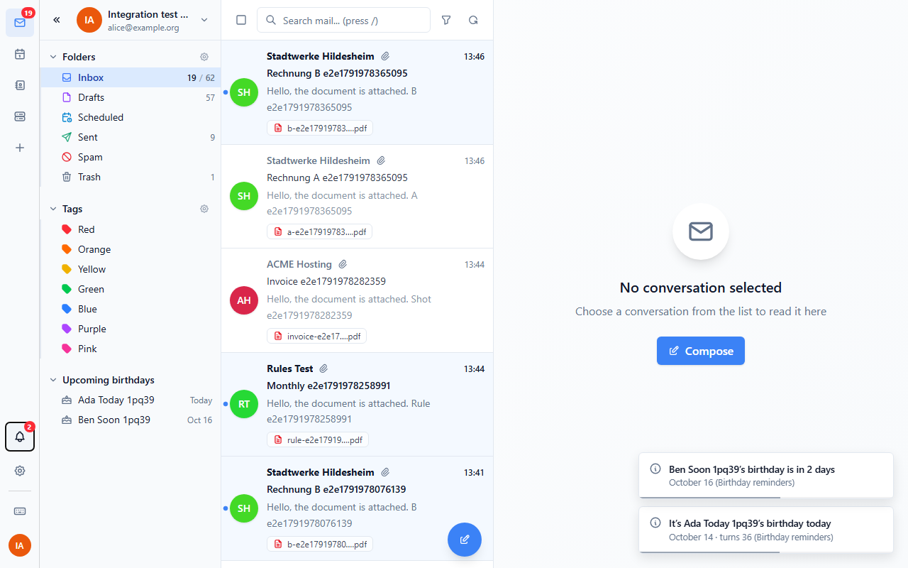
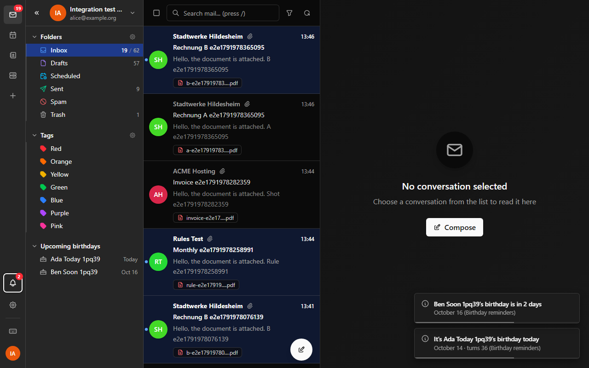
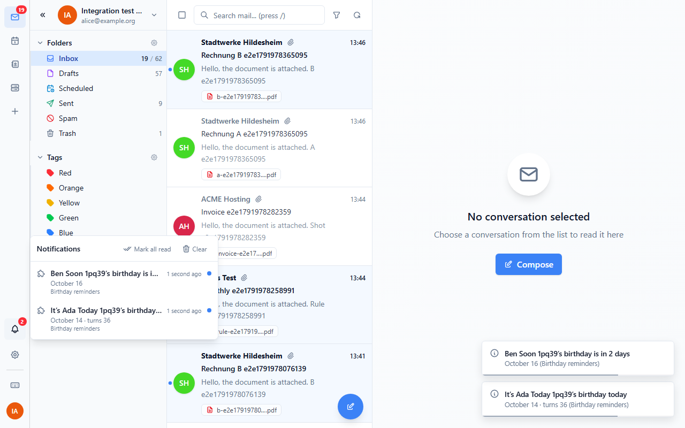
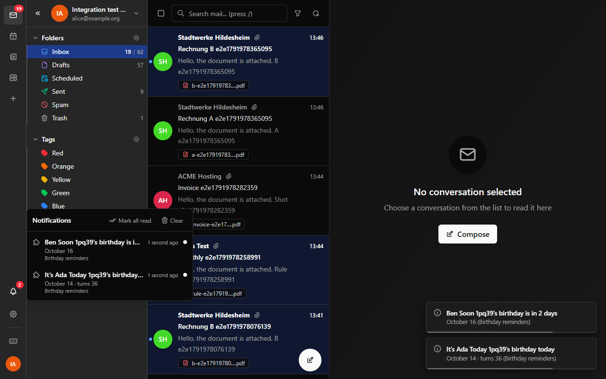
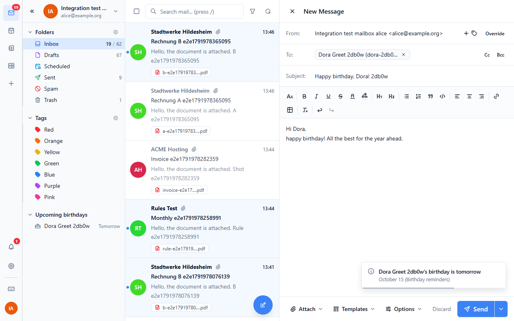
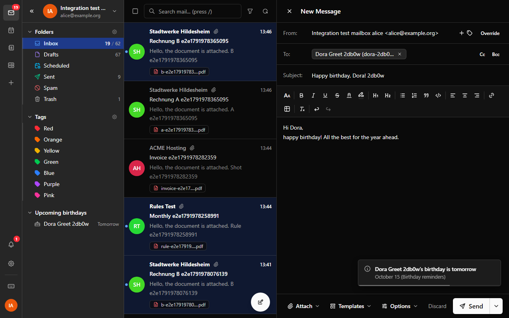
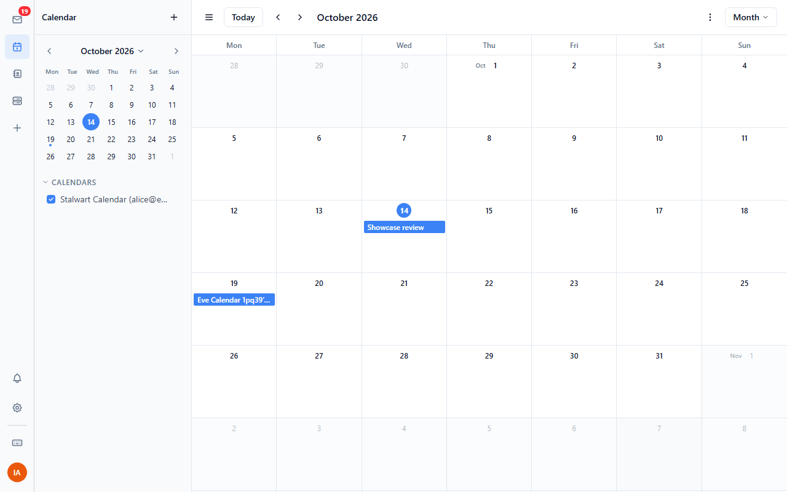
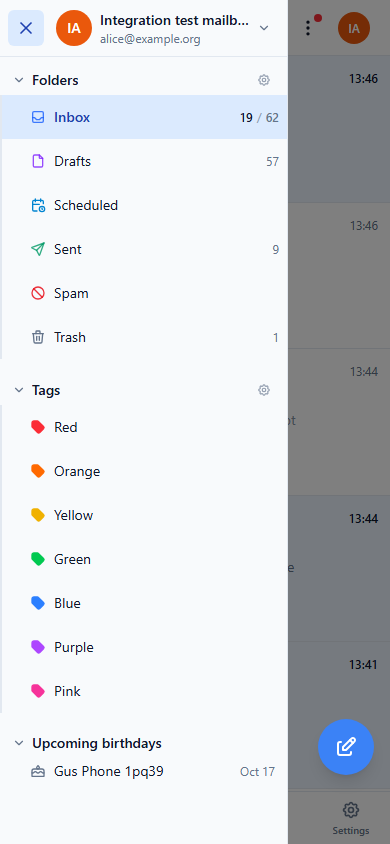

# Birthday reminders

Shows upcoming birthdays from your contacts in the mail sidebar, reminds you
of them, opens a birthday greeting with one click and, if you want, keeps
birthday events in your calendar.



## What it does

- **Sidebar section.** "Upcoming birthdays", below Folders and Tags and folded
  the same way, lists the birthdays of the next 30 days (setting), soonest
  first: the name, then "Today", "Tomorrow" or the date. The tooltip has the
  whole line ("Today · October 14 · turns 36"). It reads every address book of your
  account, refreshes every 10 minutes and when you come back to the tab. Five
  rows are shown, the rest behind "Show all".
- **Reminders.** A notification on the day ("It's Ada's birthday today") and
  one when the birthday comes within 3 days (setting; "Ben's birthday is in 2
  days"). Each contact gets at most one reminder a day, and the early one only
  once per birthday, also with several tabs open. More than three at once are
  summed up in one notification ("Birthdays today: Ada, Ben, ..."). It is a
  system notification when you allowed them for the webmail, otherwise a toast.
  Reminders are checked when the webmail starts, when the day changes, every
  hour and a few seconds after you change a contact, so the webmail has to be
  open for them; the plugin can't remind you while it is closed.
- **Send greeting.** Click a contact with an email address in the list (the
  tooltip says "Send Ada a birthday greeting"). It opens the composer addressed to them, with "Happy
  birthday, Ada!" as subject and a short line to start from, in your language.
  Nothing is sent until you press Send. Clicking a system notification for one
  contact does the same; a summary notification just brings the webmail to the
  front.
- **Birthdays in the calendar** (off by default). With "Add birthdays to my
  calendar" on, the plugin keeps one all-day event per contact on the next
  birthday in your default calendar ("Ada's birthday"), so phones and other
  CalDAV clients show them too. After the day has passed it adds the next
  year's; past ones stay as history. When a birthday changes, the event moves
  (and past events on the old date go); when a contact is deleted or its
  birthday removed, its events go; turning the setting off removes them all.
  See "How the calendar events work" below.

## Dates

- A birthday without a year is shown without an age.
- **February 29**: in years without that day the birthday is celebrated on
  **February 28**, the day before the date would roll over to March.
- Dates are read from the contact's birthday (`anniversaries` with kind
  `birth`), as JSContact partial dates, `--MM-DD` or `YYYY-MM-DD`. Wedding and
  other anniversaries are ignored, as are contact groups.

## How the calendar events work

The plugin api can't create recurring events or set an event's UID, so the
plugin can't write one `RRULE:FREQ=YEARLY` event per contact. Instead it
keeps one event for the next birthday and adds the following year's once the
day has passed (it checks at start, hourly and when the day changes). The
webmail's own "Contact birthday calendar" (Settings > Calendar) shows the same
birthdays without real events; with both on you see each birthday twice, so
use the plugin option only if you want the birthdays on other devices too.

Each event's description ends with a marker such as `[birthdays:c42]` (the
contact id). That marker is how the plugin finds its events again, also from
another browser, so it never makes duplicates, and it removes duplicates two
browsers made at the same moment. It looks a year back and a year ahead. If
you delete one of these events by hand, it comes back on the next check; turn
the setting off, or remove the birthday from the contact, instead. Changes you
make to the title or date are put back, since the contact is the source.


| Setting | Default | Meaning |
| --- | --- | --- |
| Show birthdays in the next … days | 30 | How far ahead the sidebar list looks (1-365). |
| Birthday reminders | on | Notifications on the day and a few days before. |
| Remind me … days before | 3 | When the early reminder comes (0-30). 0 leaves only the one on the day. |
| Add birthdays to my calendar | off | Keep all-day birthday events in the default calendar. Turning it off removes them. |

The setting labels are in English: the webmail shows `settingsSchema` labels
as they are and has no way for a plugin to translate them yet. Everything
else the plugin shows is translated into all 27 webmail languages.

## Permissions

| Permission | Why |
| --- | --- |
| `contacts:read` | Read the birthdays of your contacts. |
| `ui:sidebar-widget` | Show the list in the mail sidebar. |
| `ui:notifications` | Show the reminders. |
| `compose:open` | Open the composer for a greeting. |
| `calendar:read` | Find the plugin's own birthday events again. |
| `calendar:write` | Create, move and remove them, only when the calendar setting is on (or to clean up after turning it off). |

The plugin also uses the app lifecycle hooks (start, once a minute), which
every plugin has.

## Privacy

The plugin sends nothing anywhere outside your mail server. It reads your
contacts through the webmail and keeps no copy of them; the only things it
stores (in this browser) are which reminders it has shown, by contact id and
date, and whether it may have calendar events to clean up. With the calendar
setting on it writes the contact's name and birthday into your own calendar
on the same server.

## Screenshots

| | Light | Dark |
| --- | --- | --- |
| Sidebar |  |  |
| Reminders in the notification panel |  |  |
| Send greeting |  |  |
| Calendar |  | |
| Phone (menu) |  | |

## Development

```
node scripts/build.mjs birthdays
node node_modules/vitest/vitest.mjs run birthdays
BULWARK_ADMIN_PASSWORD=... node node_modules/@playwright/test/cli.js test -c e2e/playwright.config.mjs birthdays.spec
```

The end-to-end tests seed contacts in the Stalwart test server over JMAP
(`e2e/stalwart.mjs`), install the plugin as admin and remove the contacts,
events and greeting drafts they made afterwards. The admin session is kept in
a temporary file between runs (`BIRTHDAYS_ADMIN_STATE`), because the admin
sign-in allows only 5 attempts per 15 minutes.
