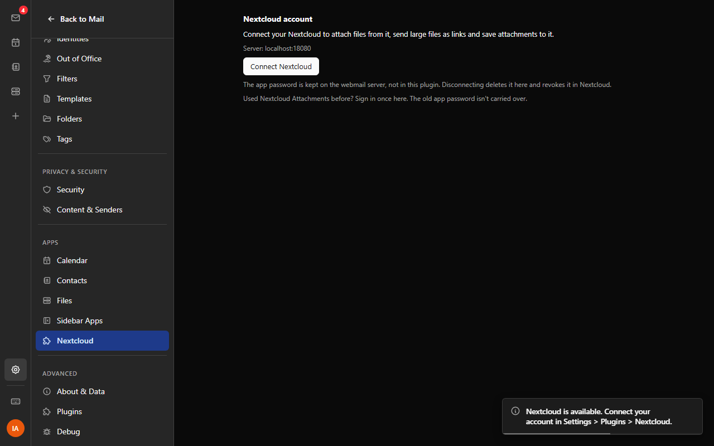
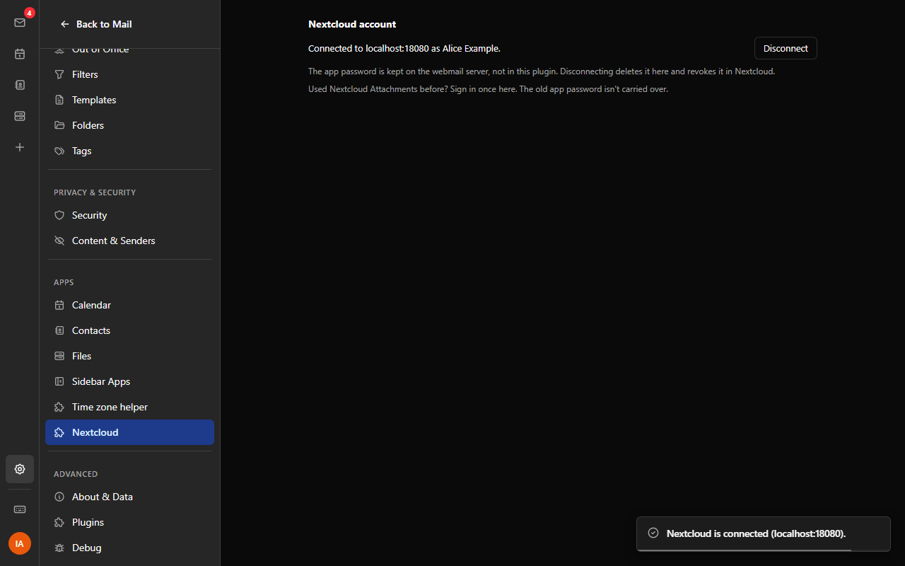

# Nextcloud

Connects Bulwark Mail to your Nextcloud.

## Connecting

Open Settings > Plugins > Nextcloud and choose **Connect Nextcloud**. The
webmail asks you to confirm the server, then opens Nextcloud's own sign-in
page (Login Flow v2) in a new tab. Sign in there and grant access. Nextcloud
creates an app password for Bulwark, and the webmail server stores it right
away. The plugin never sees it: every request goes through the webmail's
plugin proxy, which adds the password and only talks to that one server.

**Disconnect** deletes the stored password and revokes it in Nextcloud. If
the app password is revoked in Nextcloud (or expires), the plugin says so and
offers to sign in again.




## For administrators

| Setting | What it does |
| --- | --- |
| Nextcloud server (`serverUrl`) | Your organisation's Nextcloud, e.g. `https://cloud.example.com`. Users don't have to type it and can only connect to this server. Leave empty to let each user choose. |

The webmail server must be able to reach Nextcloud. A Nextcloud on a private
network has to be listed in `PLUGIN_PROXY_PRIVATE_ORIGINS`, by exact origin.
Nextcloud needs no CORS setup.

### Permissions

| Permission | Why |
| --- | --- |
| `http:proxy` | All requests to Nextcloud go through the webmail's secret proxy with the user's app password. |
| `admin:config` | Read the server address the administrator set. Users can't change admin settings with it; the server only lets admins write them. |
| `ui:settings-section` | The connect / disconnect section in Settings. |

The `nextcloud` credential is a user credential with Basic auth: the user
name and app password come from Nextcloud's Login Flow v2.

## What is sent where

Nothing goes to Nextcloud until you connect it. The plugin then only sends
what you ask it to.

## Moving from "Nextcloud Attachments"

This plugin replaces Nextcloud Attachments. The old plugin kept the app
password in plain text in the browser's plugin settings, where this plugin
can't read it (and shouldn't). So the move takes one sign-in per user:

1. The admin installs this plugin, sets the Nextcloud server under its admin
   settings, and removes the old `nextcloud-attachments` plugin.
2. On the first start, the plugin shows a short note pointing to Settings >
   Plugins > Nextcloud. The server is already filled in from the admin
   setting. The user signs in with Nextcloud once; the old app password is
   not carried over. Users can revoke the old one in Nextcloud under
   Settings > Security > Devices & sessions.

## Development

```
node nextcloud/scripts/sync-locales.mjs     # copy locales/*.json into manifest.json
node scripts/build.mjs nextcloud            # build nextcloud.zip
node node_modules/vitest/vitest.mjs run nextcloud
BULWARK_ADMIN_PASSWORD=... node node_modules/@playwright/test/cli.js test -c e2e/playwright.config.mjs nextcloud/e2e
```

Translations live in `locales/<lang>.json`, one file per webmail language.
The end-to-end tests run against the Nextcloud container from `test-env`
(user alice).
