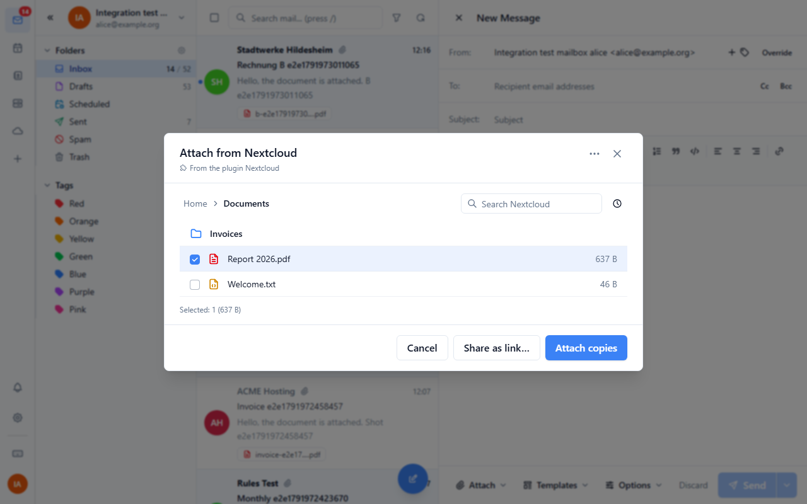
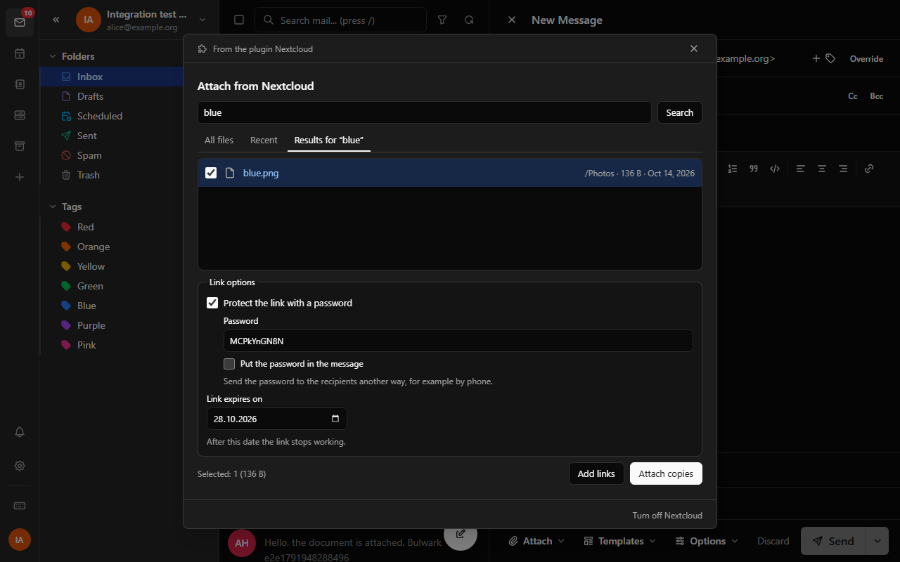
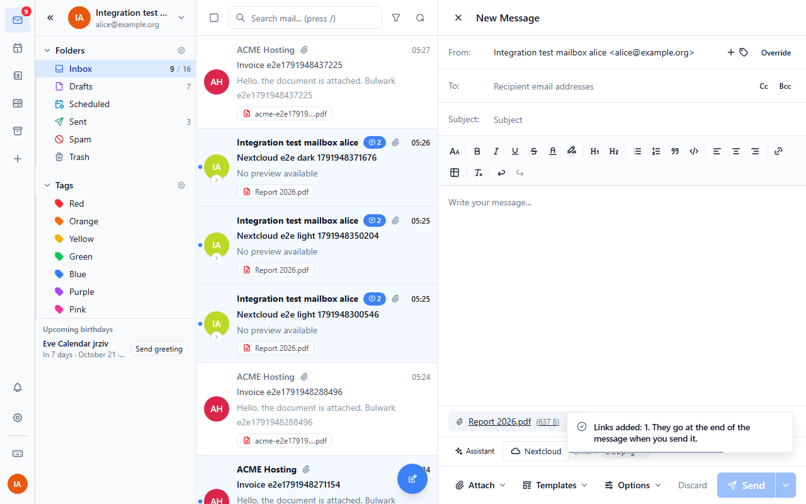
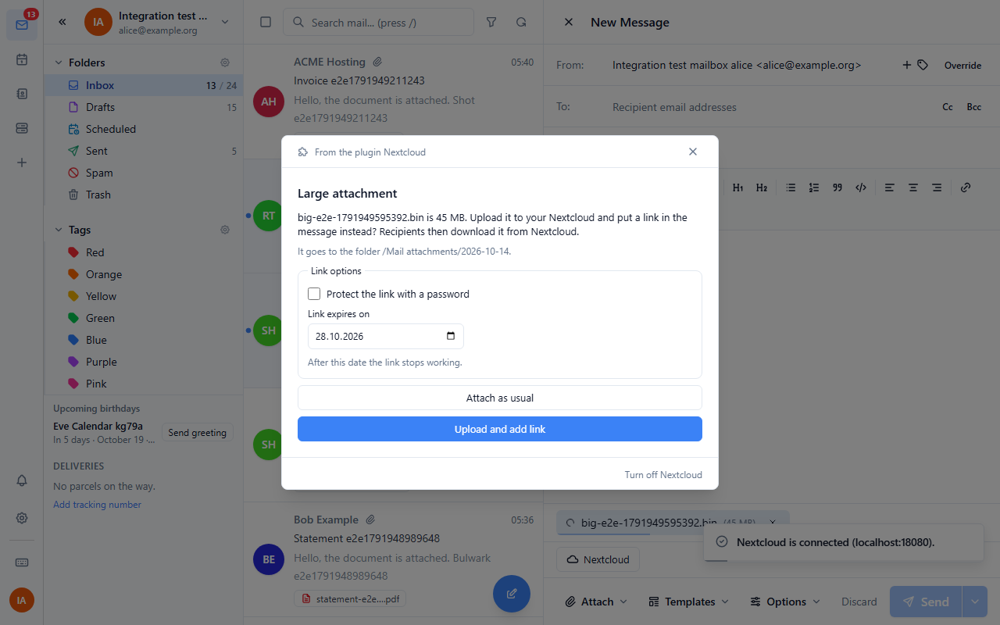
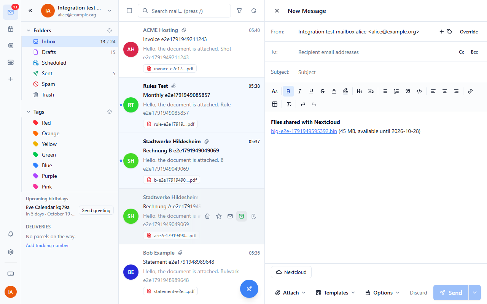

# Nextcloud

Connects Bulwark Mail to your Nextcloud.

## Connecting

Open Settings > Plugins > Nextcloud and choose **Connect Nextcloud**. The
webmail asks you to confirm the server, then opens Nextcloud's own sign-in
page (Login Flow v2) in a new tab. Sign in there and grant access. Nextcloud
creates an app password for Bulwark, and the webmail server stores it right
away. The plugin never sees it: every request goes through the webmail's
plugin proxy, which adds the password and only talks to that one server.

**Disconnect** deletes the stored password and revokes it in Nextcloud. If
the app password is revoked in Nextcloud (or expires), the plugin says so and
offers to sign in again.


## Attach from Nextcloud

In the composer, the **Nextcloud** button (in the row under the message)
opens a file picker. Browse your folders, look at **Recent** files or search
by name, and pick one or more files. Then:

- **Attach copies** downloads the files through the proxy and attaches them
  like any other attachment.
- **Share as link…** creates a public, read-only Nextcloud link for each file.
  You can protect the links with a password (the plugin suggests one that
  meets your server's password rules) and set an expiry date. The links show
  as chips next to the button and are added at the end of the message when
  you send it. The password is only written into the message if you tick
  **Put the password in the message**; otherwise send it some other way.
  Links picked for a message you then discard are dropped.





## Large attachments

When you attach a file of 10 MB or more (adjustable), the plugin asks whether
to upload it to your Nextcloud and put a share link in the message instead.
The same link options apply. Files larger than 10 MB go up in 10 MB chunks
(Nextcloud's chunked upload v2) with a progress bar. **Cancel** pauses the
upload; **Resume upload** continues with the chunks the server already has,
also after a failed chunk. Short network errors are retried by themselves.
**Attach as usual** (or closing the dialog) attaches the file normally.

Uploads go to the upload folder, by default `Mail attachments/<date>`. A
file with the same name gets " (2)" added.




## Settings

User settings (Settings > Plugins > Nextcloud):

| Setting | Default |
| --- | --- |
| Protect share links with a password | off |
| Share links expire after (days), 0 = never | 14 |
| Offer to send large attachments as a Nextcloud link | on |
| Large attachment size (MB) | 10 |
| Upload folder | Mail attachments |
| Folder layout (`date`: a subfolder per day, `flat`) | date |

## For administrators

| Setting | What it does |
| --- | --- |
| Nextcloud server (`serverUrl`) | Your organisation's Nextcloud, e.g. `https://cloud.example.com`. Users don't have to type it and can only connect to this server. Leave empty to let each user choose. |

The webmail server must be able to reach Nextcloud. A Nextcloud on a private
network has to be listed in `PLUGIN_PROXY_PRIVATE_ORIGINS`, by exact origin.
Nextcloud needs no CORS setup.

### Permissions

| Permission | Why |
| --- | --- |
| `http:proxy` | All requests to Nextcloud go through the webmail's secret proxy with the user's app password. |
| `admin:config` | Read the server address the administrator set. Users can't change admin settings with it; the server only lets admins write them. |
| `ui:settings-section` | The connect / disconnect section in Settings. |
| `ui:composer-toolbar` | The Nextcloud button in the composer (`composer-attachment-source`). |
| `email:blob-write` | Upload a file picked in Nextcloud to the mail server to attach it. |
| `email:send` | Add the picked share links to the message when it is sent (`onTransformOutgoingEmail`). |
| `email:read` | Drop links picked for a discarded message (`onComposerClose`). |
| `email:blob-read` | Read a large file you just attached (`upfiles.get`) to upload it to Nextcloud. |

`email:blob-write` also covers the `onBeforeBlobUpload` hook, which is how the
large-attachment offer gets in before the file is uploaded to the mail
server.

The `nextcloud` credential is a user credential with Basic auth: the user
name and app password come from Nextcloud's Login Flow v2.

## What is sent where

Nothing goes to Nextcloud until you connect it. The plugin then only sends
what you ask it to: folder listings and searches while the picker is open,
a share request for each file you share as a link, and the large files you
choose to upload.

## Moving from "Nextcloud Attachments"

This plugin replaces Nextcloud Attachments. The old plugin kept the app
password in plain text in the browser's plugin settings, where this plugin
can't read it (and shouldn't). So the move takes one sign-in per user:

1. The admin installs this plugin, sets the Nextcloud server under its admin
   settings, and removes the old `nextcloud-attachments` plugin.
2. On the first start, the plugin shows a short note pointing to Settings >
   Plugins > Nextcloud. The server is already filled in from the admin
   setting. The user signs in with Nextcloud once; the old app password is
   not carried over. Users can revoke the old one in Nextcloud under
   Settings > Security > Devices & sessions.

## Development

```
node nextcloud/scripts/sync-locales.mjs     # copy locales/*.json into manifest.json
node scripts/build.mjs nextcloud            # build nextcloud.zip
node node_modules/vitest/vitest.mjs run nextcloud
BULWARK_ADMIN_PASSWORD=... node node_modules/@playwright/test/cli.js test -c e2e/playwright.config.mjs nextcloud/e2e
```

Translations live in `locales/<lang>.json`, one file per webmail language.
The end-to-end tests run against the Nextcloud container from `test-env`
(user alice).
