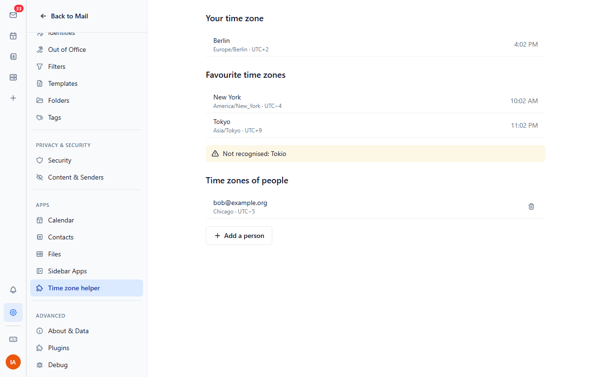
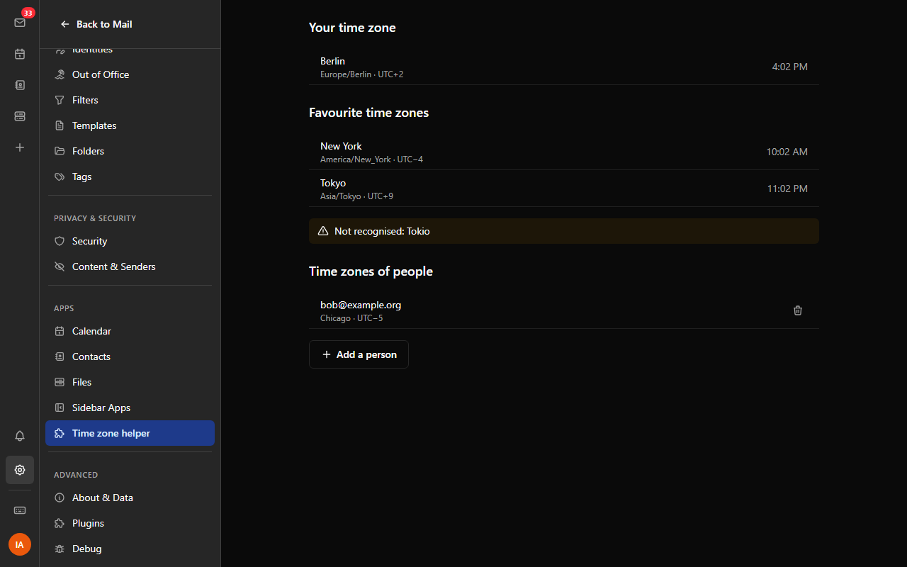
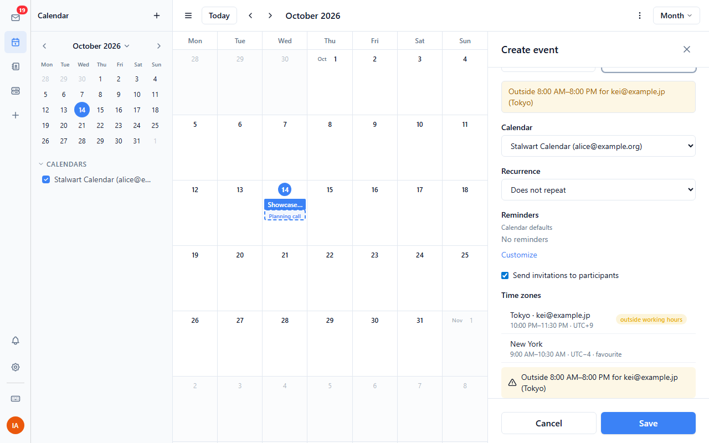
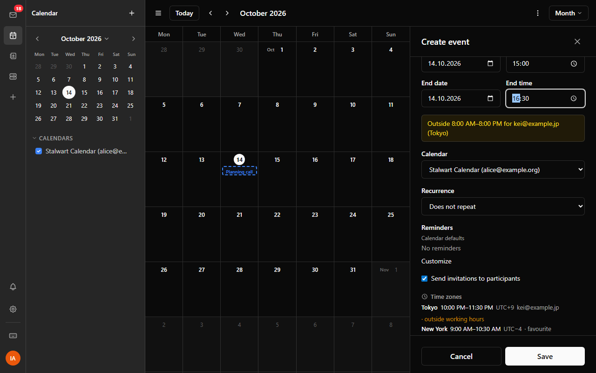
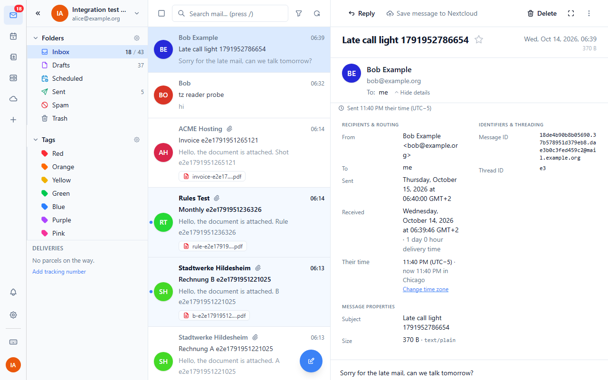
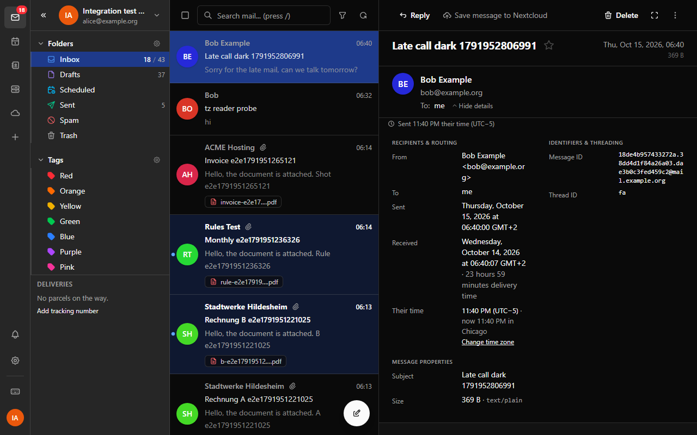

# Time zone helper

Shows the time where the people you write to are.

## Settings

Under Settings → Plugins → Time zone helper:

- **Favourite time zones**: cities or zones separated by commas, for example
  `Berlin, New York, Asia/Tokyo`. City names, IANA zone ids in any case and a
  few common aliases (Munich, San Francisco, Mumbai) are understood.
- **Your time zone**: leave it empty to use your browser's zone. Set it when
  you picked another time zone in the webmail's own settings (plugins can't
  read that setting).

The plugin also gets its own page in Settings (**Time zone helper** under
Apps). It shows how your favourites were understood, points out entries it
didn't recognise, and lists the time zones you set for people (by email
address), where you can add or remove them.

The settings fields themselves are labelled in English: the webmail shows a
plugin's setting labels as written in its manifest.

## Event form

The form for a new or edited event gets a **Time zones** section. It shows
the event's time for every participant whose time zone you set, and in each
of your favourite zones, with "next day" or "previous day" when the date
differs. Participants without a zone are listed with a **Set** link, so you
can pick their zone right there; it is remembered for that address.

When the event falls outside working hours (08:00 to 20:00 by default, see
**Working hours start** and **Working hours end** in the settings) for a
participant, the form shows a warning next to its other warnings, for
example "Outside 08:00–20:00 for kei@example.jp (Tokyo)". Favourite zones are
only marked, not warned about. The warning appears when the times change
(the form re-checks then); all-day events get none.

The section reads the event's own time zone. The warning is worked out from
the times in the form and your time zone setting (or your browser's).

## Reading mail

A message's Date header keeps the UTC offset the sender's computer used.
When it differs from yours, a line under the sender says when they wrote it
on their own clock, for example "Sent 11:40 PM their time (UTC−5)". In the
message details (Show details), a **Their time** row under Recipients &
routing shows the same, and lets you set the sender's time zone. Once it is
set, both places add the time it is there now.

The offset only says where the sender's clock was when they sent the
message, not which zone they are in, so the plugin never guesses a zone from
it. Headers with an unknown zone (`-0000`) show nothing.

## Permissions

| Permission | Why |
| --- | --- |
| `ui:settings-section` | The plugin's page in Settings. |
| `ui:calendar-action` | The section in the event form. |
| `ui:email-banner` | The line under the sender of the open message. |
| `ui:email-details` | The row in the message details. |
| `email:read` | To read the open message's Date header and sender address. Nothing else of the message is used. |
| `calendar:read` | To see the event in the form (times, participants) and add the working-hours warning (onCheckEventConflicts). |

## Data

Everything stays in your browser. The time zones you set for people are kept
in the plugin's storage for the signed-in account. Nothing is sent anywhere.
